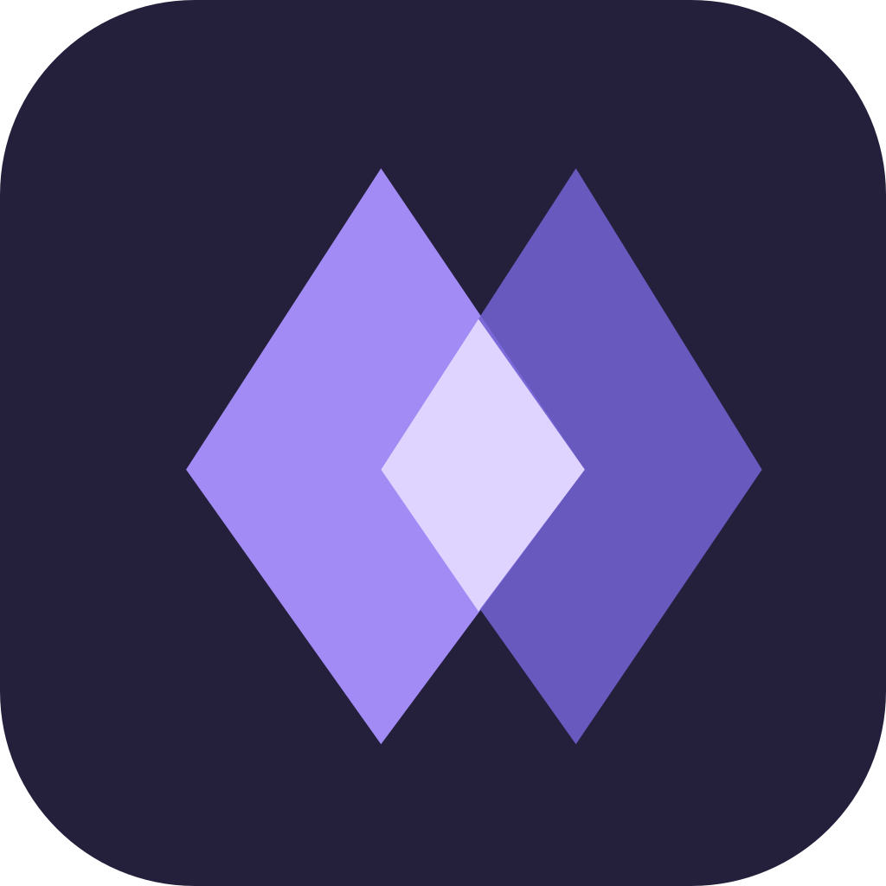
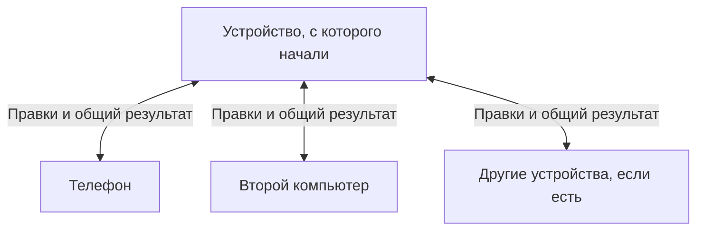

# Mica



**Your files. Your devices. No cloud.**

**Твои файлы. Твои устройства. Без облака**

Mica (ранее Synchronizer) синхронизирует папки по локальной сети между
устройствами на **Linux, Windows и Android**. Приложение написано для хранилищ
Obsidian — обычных папок с Markdown-файлами. Оно работает без облачного
аккаунта и сервера в интернете.

[Скриншоты](#скриншоты) · [Схемы синхронизации](#как-синхронизируются-устройства) · [Инструкция](#как-пользоваться) · [Сборка](#сборка)

## Скриншоты

Скриншоты появятся здесь.

<!--


-->

## Как синхронизируются устройства

### Два устройства


Mica сравнивает обе папки. В обычном режиме устройство, с которого начали,
показывает, какие изменения получит каждое из двух устройств. После нажатия
«Применить» оба получают правки, которых им не хватало.

### Три устройства и больше



Устройство, с которого начали, собирает правки всех доступных сопряжённых
устройств и передаёт им общий результат. Здесь же можно посмотреть изменения
и разрешить конфликты. Ход синхронизации виден на всех участниках.

## Как пользоваться

1. **Откройте Mica на всех устройствах в одной сети.** На вкладке
   «Синхронизация» они найдут друг друга сами. Чтобы поискать заново, потяните
   список вниз. На Windows при первом запуске разрешите доступ в частных сетях.
2. **Выберите папку.** На каждом устройстве можно выбрать одну. Если есть
   непустая папка `Documents/Obsidian`, Mica предложит её. На карточке устройства
   видны путь и размер папки. На Android разрешите приложению доступ к файлам.
3. **Выполните сопряжение.** Нажмите на карточку другого устройства и сверьте
   шестизначный код на обоих экранах. Начать может любая сторона. Если устройств
   несколько, сопрягите каждое с тем, с которого хотите запускать синхронизацию.
4. **Синхронизируйте.** Нажмите на карточку сопряжённого устройства. Если
   доступно несколько сопряжённых устройств, Mica сведёт их за один запуск.
   Если есть изменения, просмотрите их, решите конфликты и нажмите «Применить».
   Отменить синхронизацию можно на устройстве, с которого её начали.

Чтобы забыть сопряжённое устройство, удерживайте его карточку. Долгое нажатие
на свою карточку открывает переименование. Если компьютер с Windows не виден,
проверьте [брандмауэр](#брандмауэр-windows).

### Если общей сети нет

На вкладке «Напрямую» покажите QR-код на одном устройстве и отсканируйте его
на другом. QR-код уже содержит одноразовый ключ сопряжения.

Для пары телефонов Android может поднять точку доступа при показе кода.
Если в паре компьютер, подключите его к локальной сети, например к точке
доступа телефона. Покажите QR-код на компьютере и отсканируйте его на Android.

### Предпросмотр и конфликты

Правки в разных местах одной заметки сливаются автоматически. Если одно и то
же место переписали по-разному, при синхронизации двух устройств можно выбрать
правку для каждого спорного фрагмента. При синхронизации нескольких устройств
можно выбрать версию конфликтующего файла.

В предпросмотре видны новые и удалённые файлы и построчная разница. Изменения
разложены по устройствам. Сверху идут удаления (красным), затем правки и новые
файлы (зелёным). Вкладка «Дерево» показывает, какой папка станет после
синхронизации. Запись начинается после нажатия «Применить». В простом режиме
приложение сразу применяет изменения и выбирает более позднюю правку в спорных
местах.

### Обновление с Synchronizer

На Linux и Windows замените весь комплект файлов, сохранив путь установки.
На Android установите APK поверх прежней версии, чтобы сохранить каталог,
настройки и сопряжённые устройства. Для собственной сборки см. [совместимость
обновлений](#совместимость-обновлений).

## Технические подробности

### Синхронизация и сеть

- Файлы сравниваются по хешу SHA-256, а не по времени изменения.
- Тексты версий, на которых устройства сошлись в прошлый раз, лежат в
  `.synchronizer/base` под своим хешем. Это общий предок для трёхстороннего
  слияния, у каждой пары устройств свой.
- Поиск устройств - UDP-мультикаст и широковещание в каждый IPv4-интерфейс, на
  чистом Dart, без mDNS и нативных плагинов.
- Сессия аутентифицируется общим секретом из сопряжения (HMAC-SHA256, взаимно).
  Содержимое сверяется с хешем на обоих концах, запись атомарная.
- Каждая запись проверяет, что файл на другой стороне всё ещё тот, на который
  рассчитывали, поэтому одновременная синхронизация с третьим устройством не
  затирает чужие правки.
- Если устройство, с которого начали, пропадёт, остальные завершают ожидание
  после двадцати секунд тишины.

### Брандмауэр Windows

При первом запуске Брандмауэр Защитника Windows спросит про доступ к сети.
Отметьте **«Частные сети»** и нажмите «Разрешить». Сеть, в которой вы
синхронизируете, тоже должна быть частной: «Параметры → Сеть и Интернет →
свойства сети → Тип сетевого профиля → Частная сеть». Без этого компьютер не
виден другим устройствам, а они, скорее всего, не видны ему.

Если в окне нажали «Отмена», Windows запоминает запрет. Удалите правила
`synchronizer_windows` с красным значком в «Брандмауэр → Дополнительные
параметры → Правила для входящих подключений» и перезапустите приложение, либо
добавьте разрешение в PowerShell от администратора:

```powershell
New-NetFirewallRule -DisplayName "Mica" -Direction Inbound `
  -Program "C:\путь\к\synchronizer_windows.exe" -Action Allow -Profile Private
```

Разрешение привязано к пути exe: после переноса папки Windows спросит снова.
Порты, если правила задаются по ним: TCP 47800 (сопряжение и синхронизация) и
UDP 47811 (поиск устройств).

### Имена файлов в Windows

Windows молча искажает некоторые имена, допустимые на Linux и Android:
`10:30.md` превращается в файл `10` со скрытым потоком, у `черновик.` пропадает
точка, `Note.md` и `note.md` для неё один файл. Поэтому, если одно из двух
устройств - Windows, такие файлы не синхронизируются ни в одну сторону:

- с символами `< > : " \ | ? *` или управляющими символами;
- оканчивающиеся точкой или пробелом;
- `CON`, `PRN`, `AUX`, `NUL`, `COM1`-`COM9`, `LPT1`-`LPT9`, в том числе с
  расширением;
- отличающиеся от соседнего файла или папки только регистром - пропускаются оба.

Правило касается и папок на пути. Пропущенный файл остаётся на своём устройстве
и не считается удалённым на другом; приложение говорит, сколько файлов
пропущено. Чтобы файл синхронизировался, его достаточно переименовать. Между
Linux и Android ограничения нет.

### Структура репозитория

```
linux/            Приложение для Linux
windows/          Приложение для Windows
android/          Приложение для Android
assets/           Мастер-ресурсы иконки Mica
shared/sync_core/ Движок на чистом Dart: манифесты, diff, трёхстороннее слияние
shared/sync_net/  Сеть на чистом Dart: поиск, сопряжение, сессия, сведение
shared/sync_ui/   Общий интерфейс на Flutter
```

### Сборка

Нужен Flutter SDK 3.44+ с Dart 3.12+. Для Windows - ещё Visual Studio или Build
Tools с нагрузкой «Разработка классических приложений на C++».

Перед первой сборкой из чистой копии сгенерируйте общую локализацию.

```sh
(cd shared/sync_ui && flutter pub get)
```

```sh
(cd linux   && flutter run -d linux)
(cd windows && flutter run -d windows)
(cd android && flutter run -d android)
```

Готовые сборки создаются из каталога соответствующей платформы.

| Платформа | Команда | Результат |
| --- | --- | --- |
| Linux | `flutter build linux --release` | Каталог `build/linux/<архитектура>/release/bundle` целиком. Инструкции по ярлыку есть в [README для Linux](linux/README.md). |
| Windows | `flutter build windows --release` | Каталог `build\windows\x64\runner\Release` целиком. |
| Android | `flutter build apk --release` | `build/app/outputs/flutter-apk/app-release.apk` |

#### Тесты

```sh
(cd shared/sync_core && flutter test)
(cd shared/sync_net  && flutter test)
(cd shared/sync_ui   && flutter test)
```

### Совместимость обновлений

В Linux по-прежнему используется `synchronizer_desktop`, в Windows —
`synchronizer_windows.exe`. Это сохраняет совместимость с существующими
ярлыками, автозапуском и правилами брандмауэра. Настройки, сопряжения и
`.synchronizer/base` используются по прежним путям.

На Android для обновления нужны та же подпись и более высокий `versionCode`.
В репозитории код сборки повышен с 1 до 2.
Если предыдущая сборка использовала свой код, передайте более высокий через
`flutter build apk --release --build-number N`.

### Иконки

Мастер-вектор `assets/mica.svg` и исходный PNG `assets/mica.png` хранятся вместе.
Для обновления платформенных ресурсов запустите `python3 tool/prepare_icons.py`
с Pillow и `rsvg-convert`, затем `dart run flutter_launcher_icons` из `android/`.

### Ограничения

- Трафик не шифруется: сессия аутентифицирована, но идёт открытым TCP. TLS - в
  планах.
- Файл передаётся целиком через память, не больше 64 МиБ.
- Первая синхронизация папки, которая уже есть на обоих устройствах, сливает без
  общего предка и может вернуть удалённые строки; приложение об этом
  предупреждает. Дальше слияние точное.
- На Android нужен доступ ко всем файлам: системный выбор папки даёт
  `content://`-URI, а движок работает с путями. В Google Play с таким
  разрешением не пускают.
- Двоичные файлы синхронизируются целиком, их конфликты решаются выбором
  стороны.
- Для прямого подключения нужна общая локальная сеть или точка доступа.
  Через мобильный интернет соединению мешает NAT оператора. Синхронизации по
  Bluetooth в приложении нет.

### Лицензия

GNU General Public License, версия 2. [Полный текст лицензии](LICENSE).
